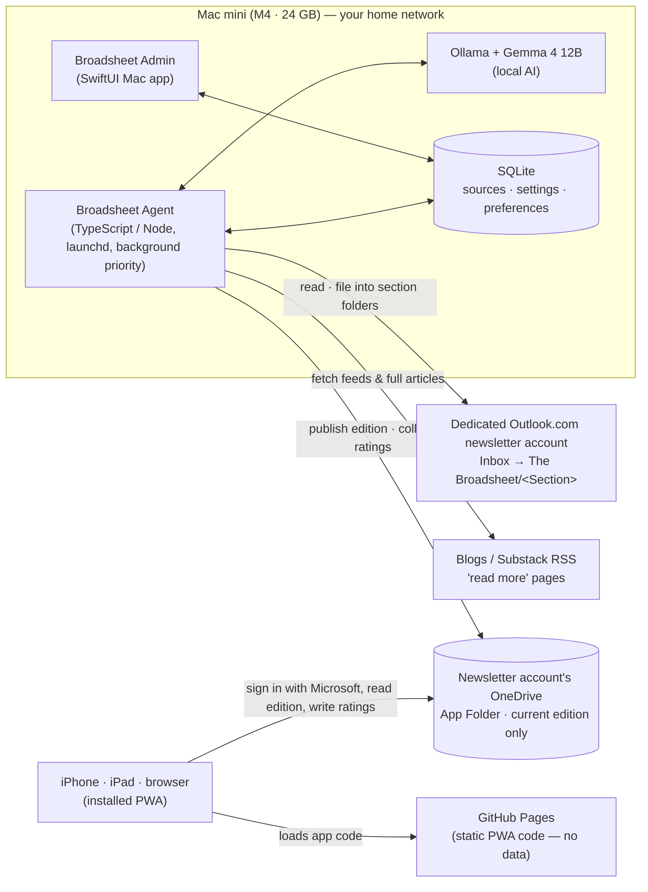

# The Broadsheet — Architecture & Implementation Plan

*Draft for review · revision 3 · 2026-11-26*

The Broadsheet turns the newsletters in your inbox (Substack and similar), plus blogs you follow by URL and later your podcasts, into a private, ranked, sectioned "newspaper". You read it on an iPhone, iPad or any web browser. All processing runs on your Mac mini (M4, 24 GB), and by default the AI runs **on the Mac mini itself**, so nothing about what you read or like leaves your house except the edition stored in your private OneDrive.

**Settled so far:**

- **Two ways in:** (1) **email** to a **dedicated Outlook.com newsletter account**, separate from your personal mail, with emails filed into Outlook folders that mirror the sections; (2) **direct feeds**, authors you follow by URL with no email signup, read through RSS.
- **Dedicated account (decided):** the Broadsheet signs in only to the newsletter account (mail and OneDrive) and never touches your personal mailbox. Its free 5 GB OneDrive holds the edition.
- **Long-term data:** only your **sources and settings** and **what your ratings say about your tastes**. All content (summaries, article text, images) is deleted after the 3–4 day window. Your newsletter emails stay in the newsletter mailbox; the Broadsheet keeps no copy. The full list is in [§7.1](#71-what-is-kept-long-term-and-where).
- **Data store:** a OneDrive App Folder (confirmed). The code lives in a public GitHub repo, and others fork it to their own repo.
- **Reader devices:** nothing installed on them. The reader starts as a PWA; native iOS is possible later.
- **Admin console:** a native Mac app on the Mac mini only.
- **AI:** **Gemma, run locally through Ollama**, is the only AI for now. It sits behind a pluggable interface, so other providers (Apple's on-device model, the Claude API) could be added later without a redesign.
- **Shared machine:** the Mac mini is also your personal computer, so the agent must stay out of your way when you're using it.

The decisions still open are in [§13](#13-decisions-for-you).

---

## 1. System at a glance



**How the pieces fit:**

- **Code and data are kept apart.** GitHub Pages serves only the PWA's code, which is public and holds nothing personal. Your content sits in a private OneDrive App Folder that only your Microsoft sign-in can open.
- **The Mac mini only makes outbound connections.** No inbound ports, port forwarding or VLAN are needed. A separate Ubiquiti network is optional extra isolation.
- **Content is short-lived everywhere.** OneDrive holds only the current edition (the last few days of items plus queued ratings), and the Mac mini holds content only for that same window. What lasts is listed in [§7.1](#71-what-is-kept-long-term-and-where).
- **One Microsoft sign-in for everything: the newsletter account.** It covers mail (the agent), the OneDrive App Folder (the agent and the PWA), and one Entra app registration. Your personal Microsoft account isn't involved. Microsoft ended password sign-in for Outlook.com IMAP in 2024, so Microsoft sign-in was required anyway.

### Repositories

- **`broadsheet` (public):** all source code, docs and the GitHub Pages deployment. Other people fork it and deploy their own copy.
- **`broadsheet-private` (optional, private):** a nightly encrypted export of your sources, rules, settings and preferences (a few hundred KB). Not needed to run anything; Time Machine on the Mac mini is enough on its own.

The PWA's per-person settings, mainly the Entra client ID, aren't secret. They're entered as GitHub Actions *variables* in each fork's settings, so the code itself stays generic.

---

## 2. Technology choices

| Component | Language / stack | Why |
|---|---|---|
| **Agent** (Mac mini) | **TypeScript on Node.js 26**, which runs `.ts` files directly | One language shared with the PWA, so the data contract is defined once. First-party SDKs for Microsoft sign-in (`@azure/msal-node`) and Graph, plus the official Ollama client (`ollama`). It also reads activity signals from built-in macOS tools ([§6](#6-sharing-the-mac-politely)). Mozilla's Readability for article extraction. TypeScript comes from the designer of C#. |
| **Reader** (all devices) | **TypeScript + React + Vite, as a PWA** | React has the largest ecosystem and an official Microsoft sign-in wrapper (`@azure/msal-react`). `vite-plugin-pwa` adds offline support and home-screen install. |
| **Admin console** (Mac mini) | **Swift + SwiftUI** | A native Mac app with a menu-bar status item, Keychain access and job control. Its declarative UI and data binding are close to WPF/XAML. The only Swift in the project, and not needed until Phase 3. |
| **Shared data contract** | Zod schemas → JSON Schema → generated Swift `Codable` types | One source of truth for the edition format and the database records. |
| **Database** | SQLite (WAL). Node's built-in `node:sqlite` with plain SQL migrations in the agent (no native add-ons to build), GRDB.swift in Admin | Embedded, zero administration, one file to back up. Plain SQL is also the neutral contract between the TypeScript agent and the Swift Admin. **Drizzle ORM** was considered: its stable 0.x line needs the native `better-sqlite3` add-on, and its `node:sqlite` support is only in the long-running 1.0 beta. Revisit once Drizzle 1.0 is stable; switching is cheap because the schema is plain SQL. |
| **AI** | **Ollama + Gemma 4 12B**, behind a pluggable `LlmProvider` interface | See [§5](#5-ai-gemma-via-ollama). |
| **Scheduling** | `launchd` LaunchAgent (per-user) at background priority | See [§6](#6-sharing-the-mac-politely). |
| **Secrets** | macOS Keychain | Holds the Microsoft sign-in tokens. |
| **Tooling** | pnpm workspaces, Vitest, GitHub Actions; Xcode only for the Admin app | Standard, free tools. |

---

## 3. Content intake & data flow

### 3.1 Two ways in

| | **Email sources** | **Direct feeds** |
|---|---|---|
| How you add one | Subscribe using the newsletter account's address. That's it: everything in that Inbox is included by default ([§3.2](#32-choosing-which-emails-to-include)). | Paste the author's URL in Admin and click **Follow**. No email signup. |
| What arrives | The email itself, in the newsletter account's Inbox | New posts from the site's RSS/Atom feed |
| After 3–4 days | The email **stays in the newsletter mailbox**, filed in its section folder. The Broadsheet deletes its own copy of the content. | The post is deleted. |
| Paid posts | Yes: the full paid post is in the email | Free posts only; paid posts arrive as previews |
| Best for | Authors you pay for, senders with no feed, and emails you want kept in Outlook | Free authors you'd rather not get email from |

Both channels feed the same pipeline, sections and ranking. A source can change channels. **Switch to feed** on an email source in Admin starts following its feed, and shows that source's unsubscribe link in case you want to stop the emails. Admin reminds you that once the emails stop, this author's future posts **won't be in your mailbox**.

### 3.2 Choosing which emails to include

The agent supports two **mailbox modes**, set in Admin:

| Mode | What's processed | Who it's for |
|---|---|---|
| **Dedicated mailbox** (your setup, the default) | **Everything in the Inbox**, except junk, account and transactional mail, and anything you exclude | A mailbox used only for newsletters, like yours |
| **Shared mailbox** | **Only** email matching include rules | Someone you share the Broadsheet with who points it at their everyday mailbox |

#### In dedicated-mailbox mode
- **Everything that lands in the Inbox is included.** A new sender becomes a source automatically and appears in Admin as **New**, so you can rename it, set a section, or mute it.
- **Junk is never read.** Outlook's junk filter runs as usual, and the agent never opens the Junk folder. If a newsletter lands in Junk, mark it *Not junk* in Outlook and it's picked up on the next run.
- **Account and transactional mail is skipped automatically** and left in the Inbox. Examples:
  - sign-in links and codes (Substack's "Your login link"),
  - payment receipts and subscription confirmations,
  - Microsoft account and security notices,
  - welcome emails with no article content.

  These are recognized from their senders and headers, and the fact that they don't look like an article. Admin lists what was skipped, in case one was a real post.
- **Exclude rules** handle anything else you don't want, such as an author whose emails you keep but don't want in the paper. Conditions: sender address or domain, subject contains / matches, mailing-list ID, body contains. These are the **Check** rules of [§4.3](#43-hiding-things-and-rules-in-plain-english), which also covers hiding items from the reader and rules written in plain English.
- **Fixed sections:** any source or rule can send its emails straight to one section.

#### In shared-mailbox mode
Nothing is processed unless it matches. The ways in are: approving **Pending** senders that the agent spots from newsletter headers (`List-Unsubscribe`, `List-Id`, the signatures of Substack, beehiiv, Ghost, Buttondown, Kit, Mailchimp, Medium and others) and from article-like content; **include rules** (the same conditions as above, plus **Outlook category**); and the **`_Add` drop folder**.

#### In both modes
- **Drop folder:** move any email into `The Broadsheet/_Add` and it's processed on the next run. One older than the retention window is filed in its section folder (Gemma picks the section) but isn't added to the paper. In dedicated mode this is mainly for something that was skipped as transactional by mistake.
- **Test before saving:** Admin shows which of the last 90 days of emails a rule would have matched.
- **Content source:** for email sources, the content comes **from the email itself**. The agent parses the full message (MIME), takes the HTML part (or plain text if there's no HTML), and cleans it. RSS is a helper here, never a requirement ([§3.4](#34-the-best-version-of-each-post)).
- **Privacy:** the agent signs in only to the mailbox you give it. In shared mode it reads only headers until an email matches, and mail that doesn't match is never stored.

### 3.3 Following by URL (direct feeds)

In Admin, choose **Follow by URL** and paste an author's or publication's address. The agent finds the feed and shows a preview of the latest posts before you confirm.

| Platform | How the feed is found |
|---|---|
| Substack (including custom domains) | `/feed` |
| Ghost | `/rss/` |
| beehiiv | The publication's RSS feed, if the author has turned it on |
| Medium | `medium.com/feed/@author` or `/feed/<publication>` |
| WordPress and most blogs | `/feed/`, or the page's `<link rel="alternate" type="application/rss+xml">` |
| Anything else | Feed discovery from the page's links; otherwise it reports "no feed found" |

**No feed?** Admin says so and suggests subscribing by email with the newsletter account instead. Scraping pages that have no feed is possible but brittle, so it isn't in the initial plan.

**Polling:**
- Each feed is checked about hourly with `ETag`/`If-Modified-Since`, so a feed with nothing new costs almost nothing.
- Feeds that post rarely are checked less often, down to a few times a day.
- When you first follow a feed, the last few days of posts are pulled in.
- The feed also supplies each source's **latest post date** in Admin.

### 3.4 The best version of each post

The same post can exist three ways: the email, the feed item and the web page. The agent keeps every version it gets, and uses the most complete one for reading and summarizing:

1. **The email body**, if it holds the full post (paid posts and most Substack emails do).
2. **The feed item**, if the email is a teaser but the feed has the full text (common for free posts).
3. **The web page**, extracted with Readability, if both are teasers. Public pages only; it never bypasses a paywall.

Duplicates are merged by canonical URL, falling back to title and date, so a post that arrives by both email and feed appears once.

### 3.5 After the retention window

When an item is older than the retention window (3–4 days) and you haven't saved it:

- **Deleted:** its article text, cleaned HTML, summary, key points, cached images, and its files in OneDrive.
- **Email:** untouched in the newsletter mailbox, in its section folder. That mailbox is your long-term record of the newsletters. (Emails of items you **hid** are in Deleted Items instead; see [§4.3](#43-hiding-things-and-rules-in-plain-english).)
- **Kept:** only a small *preference record*, and only if you rated or moved the item: source, author, section, tags, date, title, link and your rating. No text. This is what lets the Broadsheet keep learning what you like ([§7.1](#71-what-is-kept-long-term-and-where)).
- **Unrated items** leave nothing behind except a short-lived "already seen" ID, so the same post isn't processed twice.

### 3.6 Each run

Each run has two stages. **Stage A** is light and always runs. **Stage B** is the heavy AI work and runs only when the Mac is idle ([§6](#6-sharing-the-mac-politely)).

#### Stage A — light (seconds, mostly network)
1. **Collect ratings**, section corrections, hides and rule requests from `OneDrive/ratings/`, apply them, then delete the files.
2. **Fetch new mail** from the Inbox (received within the retention window, and not already seen) and everything in `_Add`. Messages are addressed by Graph *immutable ids*, so an email keeps its id when it's moved between folders. (A simple listing replaced the planned *delta query*: the Inbox stays small, and a listing can't lose its place the way a delta link can expire.)
3. **Decide what's included** ([§3.2](#32-choosing-which-emails-to-include)).
   - **Included** (in dedicated mode: everything not excluded, and not transactional or account mail): moved right away, to its section folder if the source has a fixed section, otherwise to `_Sorting` ([§4.1](#41-email-folders-mirror-the-sections)). New senders become sources marked **New**.
   - **Account or transactional mail:** left in the Inbox.
   - **Matches a Check rule** ([§4.3](#43-hiding-things-and-rules-in-plain-english)): moved to Deleted Items or left in the Inbox, as that rule says, and listed as hidden.
4. **Poll the feeds** that are due ([§3.3](#33-following-by-url-direct-feeds)).
5. **Clean up the content** (Readability throws away images in table-based email layouts, so emails are cleaned directly; Readability is kept for web pages):
   - Sanitize the HTML, and strip tracking pixels and boilerplate.
   - Unwrap click-tracking redirects and drop `utm_*` parameters.
   - Pull out the author, publication, canonical URL and hero image.
   - Download the images.
6. **Choose the best version** of each post and merge duplicates ([§3.4](#34-the-best-version-of-each-post)).
7. **Record each item as seen** (message ID and URL hash), so it's never processed twice.
8. **Publish right away.** New items appear with their opening paragraphs and a "summary pending" tag, so the news never waits for the AI.

#### Stage B — AI (only when the Mac is idle)
9. **Enrich each item** with Gemma ([§5](#5-ai-gemma-via-ollama)): summary, key points, section, tags, read time and a "why it's here" line. Gemma also checks the item against your **Instruction** rules and hides it if one applies ([§4.3](#43-hiding-things-and-rules-in-plain-english)).
   - **Draft rule suggestions** from items you hid and rules you typed, with a preview of what each would hide.
10. **File the email** from `_Sorting` into its section folder.
11. **Rank and republish** ([§4](#4-sections-ranking--personalization)). Write the new item files, then swap `edition.json` in one step. Prune items older than the retention window ([§3.5](#35-after-the-retention-window)).
12. **Write `status.json`**: last run, backlog, deferrals, errors and model used.

Weekly, when idle: rebuild your **reader profile** and flag stale sources.

---

## 4. Sections, ranking & personalization

### 4.1 Email folders mirror the sections

Sections are defined once in Admin and used in two places: the PWA's newspaper sections and your Outlook folders.

```
Inbox
The Broadsheet/
  Current Events
  Financial & Retirement
  Technology
  Gardening
  Outdoors
  Everything Else
  _Sorting          ← newsletters waiting for the AI to assign a section
  _Add              ← drop any email here to include it (§3.2)
```

- **On arrival (Stage A):**
  - If the source has a **fixed section** set in Admin (e.g. *a gardening newsletter → Gardening*), the email goes straight to that folder.
  - Otherwise it goes to `The Broadsheet/_Sorting`, so your Inbox is cleared within the hour even while the AI is waiting for an idle moment.
- **After classification (Stage B):** the email moves from `_Sorting` to its section folder.
- **Corrections:** in the PWA you can choose **Move to section…** on an item. The agent then moves the email to match and uses the correction to classify that source better next time.
- **Admin manages the folders.** Adding, renaming, reordering or removing a section creates, renames or removes the matching Outlook folder through Microsoft Graph.
  - **Removing a section** asks where its existing emails should go, defaulting to *Everything Else*. Nothing is ever deleted.
  - **First-run adoption:** if a `The Broadsheet` folder already exists, Admin uses it rather than creating a duplicate.
- **Optional mark as read:** a setting, off by default, marks filed emails as read.

Graph access needed: `Mail.ReadWrite`, which covers reading, moving and managing folders. The agent never sends mail and never **permanently** deletes it. The only mail it removes is what you hide, or what your rules hide, and that goes to **Deleted Items**, where **Show it again** can restore it ([§4.3](#43-hiding-things-and-rules-in-plain-english)). Outlook may empty Deleted Items on its own schedule, depending on your Outlook settings.

### 4.2 Ranking

```
score = w_c · content_relevance + w_a · author_affinity + w_f · freshness (+ exploration bonus)
defaults: w_c = 0.45, w_a = 0.35, w_f = 0.20 (tunable in Admin)
```

- **Content relevance** combines two signals, because small local models are weaker at "will this person like it?":
  - **Learned topic affinity**, computed from your ratings with ordinary statistics, not AI. Each item's tags and section are matched against how you've rated items with those tags. Reliable and free.
  - **Interest match:** Gemma scores the item against your short **reader profile**. The balance between the two signals is tunable in Admin.
- **Author affinity:** the average of your ratings for that author (👍 +1, 👌 0, 👎 −1), smoothed toward neutral until there are enough ratings.
- **Freshness:** decays to zero at the retention cutoff.
- **Exploration:** a small boost for unrated sources, so the Broadsheet doesn't narrow itself to only what it already knows you like.
- **Section hints:** when you move a source's items to the same section twice in a row, its new items go there too.
- **Your own words.** Ratings say *what* you liked, never *why*. A 👎 on a story you see as a political distraction would otherwise teach "less of this person" when you meant "less of this kind of story". So the reader profile starts from a few sentences you write yourself, such as *"Rank lower the stories about gossip and spectacle, like celebrity feuds or horse-race polling, unless they cover real policy or money."* Gemma reads them for every item, and they win over anything learned from ratings. You edit them in the reader (**In your own words**, on the Rules page) and in Admin. After a change, Gemma re-scores the current items while you're away.
- **An optional "why" on 👍 👌 👎.** Like the note on hiding: skip it on the phone, add a sentence when you have time. The note is kept in the preference record and goes into the weekly profile rewrite, so Gemma learns the reason. A rating with a note counts at half weight in the tag and author statistics, since the note explains it better than the tags can.
- The exact formulas, smoothing and thresholds are in [docs/phase-2.md](docs/phase-2.md#how-the-ranking-learns-p2).

The **Front Page** shows the top items across all sections, and each section tab is ranked separately.

### 4.3 Hiding things, and rules in plain English

👎 and **Don't show things like this** are separate signals. 👎 means *rank this kind of thing lower*. **Hide** means *never show this kind of thing*, such as a Substack post that's only a link to a live video.

#### Hiding an item (in the reader)
1. On any item, tap **Don't show things like this**. The item disappears at once.
2. A small sheet offers optional reasons. Tap one, or none:
   - **Not an article** (video or live-stream link, podcast link, "thanks for subscribing")
   - **Ad or promo**
   - **Not my topic**
   - **Not this author**
3. An optional text box lets you say more, such as "These live-video posts are never worth it". On a phone you'd usually skip it; on an iPad or computer you might type a sentence.
4. The email moves to **Deleted Items** in Outlook ([§4.1](#41-email-folders-mirror-the-sections)).

#### From a hidden item to a rule
- The next time the Mac is idle, Gemma looks at the hidden item, your reason and your note, and **drafts a rule**. For example: *"Hide Substack posts that are mainly a link to a live video and have little written text."*
- The draft appears as a **suggestion** on the reader's **Rules** page, with a badge showing how many are waiting. Each suggestion shows **which of the current items (the last few days) it would hide**, so you can see whether it's too broad. (Articles are kept only for the retention window, so that's the history there is to check against.)
- You **Approve**, **Edit** (change the wording, and Gemma redrafts it) or **Dismiss** it. Nothing beyond the one item you hid is hidden until you approve.
- **Writing a rule from scratch:** the Rules page also has an **Add a rule** box. Type something like "Never show posts about crypto", and it goes through the same draft, preview and approve steps.

#### Two kinds of rule, one list
When Gemma drafts a rule, it decides which kind it can be:

| Kind | Example | How it runs | Cost |
|---|---|---|---|
| **Check** | "From this sender, subject contains *is live*" | Simple conditions (sender, domain, subject, list ID, body text, links to, word count), tested in Stage A before any AI | Free, instant, the same every time |
| **Instruction** | "Skip posts that are mostly an ad for the author's course" | Plain-English text added to Gemma's prompt in Stage B. Gemma reports which rule, if any, the item breaks. | A little extra time per item |

- A rule applies to **all sources** or to **one source**. Per-source instructions also cover oddly laid-out newsletters, for example "In this newsletter, the article starts after *Today's story*; ignore the sponsor blocks."
- Gemma prefers drafting a **Check** whenever one would do, because Checks are free and predictable. Instructions should stay few and specific: a dozen is fine, but a hundred would slow every item down.
- The **exclude rules** from [§3.2](#32-choosing-which-emails-to-include) are simply Check rules. Each rule also says what happens to the email: **Deleted Items** (the default for rules made from the reader) or **leave in the Inbox** (for mail you want to keep but not see in the paper).
- **Timing:** Checks act in Stage A, so matching items never appear. Instructions need Gemma, so a matching item can show as "summary pending" for a while before Stage B hides it.

#### Seeing what was hidden
- A **Hidden** list (on the Rules page) shows every item hidden in the current retention window and why, for example *"Hidden by: live-video rule"* or *"You hid this"*.
- **Show it again** puts the item back in the paper and moves the email back from Deleted Items to its section folder. From there you can also edit or turn off the rule that caught it.
- Each rule shows how many items it hid in the last 30 days, so an over-eager rule is easy to spot.

#### Where rules are edited
Rules can be viewed and edited in **both the reader and the Admin console**:
- **SQLite on the Mac mini is the master copy.** The agent publishes the current rules and suggestions to `rules.json` in the OneDrive App Folder for the reader.
- **The reader never changes rules directly.** It writes small request files (hide, approve, edit, dismiss, add), the same way it sends ratings. The agent applies them on its next Stage A run, within about 15 minutes, and drafts with Gemma once the Mac is idle.
- **The Admin console** edits the database directly, and also has the full condition editor for Checks.
- If the same rule is edited in two places, the later change wins, and the reader shows a note if its edit was replaced.

### 4.4 Roundup newsletters

Some newsletters carry many stories in one email. Each source has a **format**:

| Format | Example | What the Broadsheet does |
|---|---|---|
| **Normal** (default) | A single essay or post | One article, as today |
| **Roundup** | A daily news roundup: about a dozen short stories, each a heading and ~120 words | Each story becomes a **brief**: a headline, one or two sentences, its section and its own link |
| **Multi-section** | A newsletter with a few substantial pieces on different subjects | Each piece becomes its **own article**, with its own summary, in its own section |

- **You choose the format** per newsletter, in Admin (until then with `broadsheet format`, or in the config file). Telling a roundup apart from a long essay isn't reliable enough to do silently with a 12B model, so the agent only **suggests** "this looks like a roundup" when an email splits into five or more short pieces (`broadsheet sources`), and you confirm.
- **Splitting uses the email's structure first, without AI:** headings, dividers, or paragraphs that start with a bold lead-in. A typical roundup has a heading over each story. Where a newsletter's layout defeats that, a per-source instruction rule says how it's laid out ("each story starts with a bold headline"). Gemma then labels and summarizes each piece, which is faster and more reliable than asking it to take a whole newsletter apart.
- **Where briefs appear:** **Current Events** briefs form a **News in Brief** column on the Front Page. Briefs for other sections (Technology, Financial & Retirement, Gardening, …) appear as an **In brief** list at the top of that section's page.
- **The same story in several roundups** is shown once, with "also in …".
- **Each brief or piece** can be rated, moved, saved or hidden like an article, and links to the full newsletter. (A link to the story's own web page waits for newsletters that give one: some roundups' links go to the sources they cite.)
- **The email** is filed in the section where most of its pieces land.

---

## 5. AI: Gemma via Ollama

All AI work runs on the Mac mini with **Gemma 4 12B** (`gemma4:12b`, installed 2026-11-26: about 8 GB, 256K-token context, text and images), served by **Ollama**. `gemma3:12b` is the fallback if Gemma 4 misbehaves. It's free, private, and needs no account or API key.

**Why 12B on a 24 GB Mac:** the 12B model takes about 8 GB while loaded. The 27B model (about 17 GB) would leave too little memory for your own use on a shared machine.

**Memory is used only while it's working:**
- The model is loaded only during Stage B. It stays loaded for the length of a batch, so the 5–10 second load happens once per batch and not once per item.
- When the batch finishes, the agent tells Ollama to **unload it immediately** (`keep_alive: 0`), so the memory comes back to you. Ollama's own idle footprint with no model loaded is only a few dozen MB.
- **Exception:** if Gemma was already loaded before the batch, the agent reuses that copy and **does not unload it**, so it never disrupts your own use of the same model.

**How it's called:**
- **Structured output:** the prompt includes the JSON schema (built from the same Zod schema as the data contract). The agent **extracts and validates the reply in code** and retries once with the validation error. Ollama's built-in schema enforcement (`format`) isn't available for `gemma4:12b`'s compressed `nvfp4` weights (Phase 0 finding), and validating in code works with any provider anyway. Fields returned: summary, key points, section, tags, interest score, read time, "why it's here", and an `is_article` flag that catches promos and thank-you notes.
- **Thinking off:** Gemma 4 "thinks" by default. Phase 0 showed thinking **on** was 2–6× slower (90–190 s versus 30–60 s per newsletter) with no better results, so the agent sends `think: false`.
- **Measured speed (Phase 0, M4 / 24 GB):** about 30–60 s per newsletter (3–5K input tokens), about 20 tokens/s output, 7.8 GB while loaded. For around 40 newsletters a day, that's roughly 20–40 minutes of idle-time work.
- **Context window:** the agent sets `num_ctx` explicitly, 16K by default and raised for long posts. The model allows up to 256K, but memory use grows with context, so it's kept modest. Ollama's default is much shorter and would otherwise cut long newsletters off **silently**. Text is converted to plain text first, which roughly halves its size. Posts still too long are summarized in sections, then combined.
- **Reader profile:** a short text (a few hundred words) sent with each item, rebuilt weekly from your ratings.
- **First real run (Phase 1, 12 newsletters):** 10–54 s per item. Gemma was too quick to call short posts "not an article" (a 400-word holiday essay, video-show posts), so the prompt now limits that to sales offers, money or vote appeals and account mail, and says "when unsure, it's an article". It still put an article about AI at work in Everything Else rather than Technology; a source's **fixed section** settles cases like that. A memory-pressure warning mid-batch stopped the run and unloaded the model, as designed. `broadsheet resummarize` has Gemma read items again after a prompt, profile or model change.

**If Ollama isn't running or a request fails:** the item stays published with its opening paragraphs and a "not summarized yet" tag, and is retried on the next idle run. `broadsheet doctor` and the Admin status show the problem.

**Room to grow:** the agent talks to an `LlmProvider` interface, not to Ollama directly. Adding another provider later means one new adapter and a setting, with no change to the pipeline. Candidates:
- a bigger or newer local model,
- Apple's on-device model,
- the Claude API.

**`broadsheet eval`:** runs the same 20 saved newsletters through a model (or two local models side by side, such as Gemma 4 12B against a newer release) and writes a local HTML page so you can judge the quality yourself before switching. The page puts each model's answers next to what the paper had and what you did (ratings, moves), with numbers for how well it ranks: the spread of its interest scores and how much higher it scores what you liked ([docs/phase-2.md](docs/phase-2.md#comparing-models-p6)).

---

## 6. Sharing the Mac politely

Your rule: when you're sitting at the Mac, the Broadsheet should be invisible. There are three layers, from cheapest to strongest.

### 6.1 Low OS priority for everything the agent does

The launchd job is configured with:
- **`ProcessType = Background`:** macOS runs it at background quality of service. On Apple silicon that means **efficiency cores only**, lowest CPU priority, and throttled disk I/O.
- **`Nice = 10`** and **`LowPriorityIO = true`**.

Stage A (mail, feeds, cleanup) is light, and at this priority you won't notice it.

### 6.2 AI work waits until you're away

The AI model itself runs in **another process**, the Ollama server. It doesn't inherit the agent's low priority, and it does its work on the GPU, which isn't scheduled the same way as the CPU. So the main protection is to **only start AI work when you're not using the Mac**.

Before Stage B, and again **between every item**, the agent checks these signals. Each is read with a built-in macOS command, so no extra software is needed (exact commands are confirmed in Phase 0):

| Signal | macOS source | Default rule |
|---|---|---|
| Time since last keyboard/mouse input | `ioreg -c IOHIDSystem` → `HIDIdleTime` | Wait until idle for the **configured threshold** (your value TBD, see §13; adjustable in Admin) |
| Screen locked | `ioreg` console-user session → `CGSSessionScreenIsLocked` | Locked counts as idle right away |
| Thermal warning | `pmset -g therm` | Skip if macOS reports a thermal warning |
| Low Power Mode | `pmset -g` → `lowpowermode` | Skip |
| Memory pressure | `sysctl kern.memorystatus_vm_pressure_level` | Skip at *critical*. At *warn*, skip only while you're at the Mac: loading the model (about 8 GB of 24) often causes the warning itself, and stopping on it while you were away stalled the paper (changed 2026-11-27) |
| CPU load | `os.loadavg()` | Skip if the 5-min load is above the threshold (e.g. a backup or export is running) |

Each item takes about a minute at most. **If you touch the mouse or keyboard, the agent finishes that item and stops.** The rest waits for the next idle moment.

### 6.3 Scheduling to match

- launchd starts the agent **every 15 minutes** rather than hourly. It's cheap, and it means idle moments are caught quickly.
- **Backlog limit** (setting): if items have waited longer than *N* hours (default 6) and you're still active, choose one of:
  - **Never while I'm active** (default): items stay published with their opening paragraphs until you step away.
  - **Trickle:** one item at a time with long pauses, only if memory pressure is normal.
- **Optional overnight window** (e.g. 1–5 a.m.) for the weekly profile rebuild and `eval` runs.
- The Admin menu-bar item shows the agent's state: **Waiting — you're active**, **Working (3 of 12)** or **Idle**, plus **Pause for 1 hour / until tomorrow**.

**Requirements:**
- **Mac settings:** *System Settings → Energy → Prevent automatic sleeping when the display is off.* The display can still sleep.
- **Login:** launchd LaunchAgents run only while you're logged in, which is the normal state on a personal Mac.

---

## 7. Data model

### 7.1 What is kept long term, and where

Everything the Broadsheet keeps for longer than the 3–4 day reading window:

| # | Data | Why it's kept | Where it's stored | How long |
|---|---|---|---|---|
| 1 | **Sources**: email senders and followed feed URLs, with name, channel, fixed section, on/off status, latest post date and post counts | The list of what feeds the Broadsheet | SQLite on the Mac mini | Until you remove the source |
| 2 | **Mailbox mode, and rules**: include rules, Check rules and plain-English Instruction rules, each with the wording you gave it ([§4.3](#43-hiding-things-and-rules-in-plain-english)) | Decides which emails are included, and what's hidden | SQLite on the Mac mini; the current list is also copied to `rules.json` in OneDrive so the reader can show it | Until you delete the rule. Dismissed suggestions are deleted. |
| 3 | **Sections** and their Outlook folder IDs | Newspaper sections and mail filing | SQLite on the Mac mini | Until you change them |
| 4 | **Settings**: ranking weights, retention, AI model choice, idle threshold and other politeness rules | Your configuration | SQLite on the Mac mini | Until you change them |
| 5 | **Preference records**: for each item you rated, moved or hid, its source, author, section, tags, title, link, date, your rating, and for hides your reason and note. **No article text.** | The raw history the ranking learns from. Kept so preferences can be recalculated if the ranking method improves. | SQLite on the Mac mini | Indefinitely; **Forget** in Admin deletes one, or all |
| 6 | **Learned preferences**: author affinity scores, tag/topic affinity scores, and your **reader profile** (a short text written by the AI describing your tastes) | What your ratings say about what you like | SQLite on the Mac mini | Recomputed continually; the reader profile keeps the last 4 versions |
| 7 | **Already-seen IDs**: email message IDs and post URL hashes | Stops the same post being processed twice | SQLite on the Mac mini | 90 days |
| 8 | **Saved items**: ones you chose **Save** for | You asked to keep them | SQLite + OneDrive (content kept) | Until you unsave them. The only content kept past the window, and only by your choice. |
| 9 | **Run log**: counts, timings, errors. No content. | Troubleshooting | `~/Library/Logs/Broadsheet/` | 14 days |
| 10 | **Microsoft sign-in token** | Access to mail and OneDrive | macOS Keychain on the Mac mini | Until you sign out or remove the key |
| 11 | **Entra client ID** (not secret) | Lets the PWA sign in | GitHub Actions variable on your fork | Permanent |
| 12 | *Optional:* encrypted export of 1–6 | Backup | Private GitHub repo `broadsheet-private` | Rolling, latest 30 nightly exports |

**Not kept by the Broadsheet past the window:** article text, summaries, cleaned HTML, images, and AI scoring details.

**Two things that last, but aren't Broadsheet data:**
- **Your newsletter emails** stay in the newsletter mailbox. The Broadsheet moves them into section folders, and moves only hidden ones to Deleted Items.
- **Each device's cached copy** of the edition is replaced as the edition updates.

**Backups:** the agent backs the database up itself, because the Mac is a personal computer that may lose power mid-run and may have no Time Machine: a compressed copy each day (the last 7 kept, in `backups/`), and once a week a copy in the private OneDrive App Folder (the last 4). Each run starts with an integrity check; a damaged database stops the run and Admin shows which backup to restore (`broadsheet restore <date>`, which keeps the damaged file beside it). Time Machine still helps for everything else on the Mac. Admin also has **Export / Import** of 1–6 as a single JSON file, which is handy for moving to a new Mac.

### 7.2 SQLite tables

The database file is `~/Library/Application Support/Broadsheet/broadsheet.db`.

| Table | Key fields | Retention |
|---|---|---|
| `sections` | id, name, sort_order, mail_folder_id, is_system (`_Sorting`, `_Add`, `Everything Else`) | Long term |
| `sources` | id, channel (`email` \| `feed` \| `podcast`), display_name, author, sender_address, feed_url, site_url, platform, status (`pending` \| `enabled` \| `muted`), fixed_section_id, last_post_at, posts_30d, avg_rating | Long term |
| `rules` | id, kind (`include` \| `check` \| `instruction`), wording (your plain-English text), conditions (JSON for include/check: sender / domain / subject / list-id / body / links-to / word count / category, AND/OR), instruction_text, scope_source_id (null = all sources), mail_action (`deleted_items` \| `leave`), fixed_section_id, status (`suggested` \| `active` \| `off`), origin (`hidden_item` \| `typed` \| `admin`), version, updated_at, updated_by, matches_30d | Long term |
| `hidden` | item_id, rule_id or null (you hid it), reason, note, hidden_at | Same as the item (**3–4 days**); the lasting part is in `preference_records` |
| `feed_state` | source_id, etag, last_modified, next_poll_at, poll_interval, last_error | Long term (no content) |
| `items` | id, source_id, channel, message_id, mail_folder_id, title, author, published_at, url, content_path, content_origin (`email` \| `feed` \| `web`), is_teaser, section_id, section_source (`fixed` \| `ai` \| `user`), tags, summary, key_points, relevance, why_its_here, score, model, ai_status, saved | **3–4 days** (unless saved), then deleted |
| `preference_records` | source_id, author, section_id, tags, title, url, published_at, rating (−1/0/+1), moved_to_section, hidden_reason, hidden_note, rated_at | Long term |
| `author_affinity`, `tag_affinity` | key, score, n | Long term (recomputed) |
| `reader_profile` | version, text, built_at, model | Last 4 versions |
| `seen` | message_id or url_hash, first_seen_at | 90 days |
| `runs` | started_at, finished_at, stage, counts, deferrals, errors, model | 14 days |
| `settings` | key → value | Long term |

Item content (cleaned HTML and images) sits in `~/Library/Application Support/Broadsheet/content/<item-id>/` while it's current, and is deleted along with the `items` row.

### 7.3 OneDrive App Folder (current edition only — short-lived)

```
Apps/The Broadsheet/
  edition.json                 # manifest: sections, ranked item cards, generated_at, schema_version
  items/<id>.html              # sanitized full content
  images/<hash>.webp           # cached copies of newsletter images (§9)
  ratings/<device>-<ts>.json   # PWA → agent: ratings, section moves, saves, hides, rule requests
  rules.json                   # agent → PWA: your rules, suggestions waiting, and the Hidden list
  status.json                  # agent health / backlog for the PWA footer
```

Ratings are written as one small file per event, so two devices rating at the same moment can't overwrite each other.

---

## 8. The apps in more detail

### 8.1 Reader PWA
- **Views:** Front Page (with **News in Brief**, [§4.4](#44-roundup-newsletters)), section tabs (each with an **In brief** list), item cards (title, source, author, age, read time, summary or "summary pending", "why it's here"), and a full-content reader with graphs and photos.
- **Item controls:** 👍 👌 👎 (with an optional "why" note), **Don't show things like this** (with optional reasons and a note), **Move to section…** (the email follows), **Save** (exempt from expiry), Mark read, Open original.
- **Rules page** ([§4.3](#43-hiding-things-and-rules-in-plain-english)): **In your own words** (the start of your reader profile, [§4.2](#42-ranking)), suggestions waiting for approval (with a badge count and a preview of what each would hide), your active rules (edit, turn off, delete), **Add a rule** in plain English, and the **Hidden** list with **Show it again**.
- **Offline:** the last edition is cached, and actions taken offline are queued and sent later.
- **Display:** follows the system dark mode; adjustable text size; layouts for iPhone, iPad and desktop.
- **Auth:** Microsoft sign-in (redirect flow) with the `Files.ReadWrite.AppFolder` scope only. The PWA can't see your mail.
- **Install:** Safari → Share → *Add to Home Screen*.

### 8.2 Admin console (SwiftUI)
- **Sections:** add, rename, reorder or remove. The Outlook folders follow, with a preview of each change ("will rename folder *Financial* → *Financial & Retirement*") before it's applied.
- **Sources**, in one list filterable by channel (Email / Feed):
  - Check or uncheck each source, set a fixed section, rename it.
  - Columns show the channel, **latest post date**, posts in the last 30 days and average rating.
  - Sources silent for a long time are highlighted with a one-click **Disable**.
  - **Switch to feed** on an email source, with a reminder that the emails will stop arriving in your mailbox ([§3.1](#31-two-ways-in)).
- **Follow by URL:** paste a Substack, Ghost, Medium, WordPress or other address; preview the latest posts, pick a section, and follow. No email signup.
- **Email:**
  - Mailbox mode (dedicated or shared).
  - **New** sources (dedicated mode) or **Pending** suggestions (shared mode).
  - The rule editor: the same rules, suggestions and Hidden list as the reader's Rules page ([§4.3](#43-hiding-things-and-rules-in-plain-english)), plus the full condition editor for Check and include rules. Conditions are sender, domain, subject, list ID, body text, links to, word count and Outlook category, with **Test against last 90 days**.
  - **Skipped mail:** what was treated as account or transactional mail, with **Include this one** for mistakes.
  - Emails dropped into `_Add`.
- **Data:** **Export / Import** of sources, rules, settings and preferences. **Forget** a rating, or forget all ratings to reset what the Broadsheet has learned. A size readout showing what's stored.
- **AI:**
  - Which Ollama model to use, and the context size.
  - **Run eval** to compare models on your own newsletters.
- **Politeness:** idle threshold, CPU/memory limits, backlog behaviour, overnight window.
- **Status and menu-bar item:**
  - The agent's current state, last run, backlog and errors.
  - **Run now** and **Pause**.
  - The log viewer.
- **Unsubscribe helper:** sources you consistently rate 👎, with each one's one-click `List-Unsubscribe` link.

### 8.3 Agent CLI
| Command | What it does |
|---|---|
| `broadsheet run [--stage a\|b] [--force]` | The launchd job. `--force` ignores the idle checks. |
| `broadsheet login` | One-time Microsoft device-code sign-in; the token is stored in the Keychain. |
| `broadsheet doctor` | Checks Microsoft sign-in, OneDrive, mail folders, Ollama and the Gemma model, and the activity signals. |
| `broadsheet backfill --days N` | First-run import. |
| `broadsheet follow <url>` | Find a site's feed and follow it (the same as Admin's Follow by URL). |
| `broadsheet rules test <rule>` | Show which recent emails a rule would match. |
| `broadsheet eval` | Side-by-side comparison of AI models on saved newsletters. |
| `broadsheet pause 1h\|tomorrow\|off` | Pause scheduled runs (Admin's menu bar does the same). |
| `broadsheet sources`, `source`, `sections`, `rules`, `rule`, `hidden`, `act`, `mail`, `follow`, `switch-to-feed`, `settings`, `set`, `ai`, `storage`, `export`, `import`, `forget` | What Admin runs; each works from Terminal too ([docs/phase-3.md](docs/phase-3.md)). |

Logs are written as structured JSON to `~/Library/Logs/Broadsheet/`.

---

## 9. Privacy & security

- **The public repo holds code only.** The edition, ratings, sources and profile live only in your OneDrive App Folder and on the Mac mini.
- **Content stays home.** All AI runs locally with Gemma, so newsletter text and your reader profile never leave the Mac mini for AI processing.
- **Least access:**
  - The agent gets `Mail.ReadWrite`, `Files.ReadWrite.AppFolder` and `offline_access`. It never deletes or sends mail.
  - The PWA gets only `Files.ReadWrite.AppFolder`.
- **Your personal mail is out of reach.** The agent and PWA sign in only to the dedicated newsletter account. Your personal Microsoft account and mailbox are never connected to the Broadsheet ([§3.2](#32-choosing-which-emails-to-include)).
- **Content is short-lived.** Article text, summaries and images are deleted after the 3–4 day window, both on the Mac mini and in OneDrive. What does last is listed in [§7.1](#71-what-is-kept-long-term-and-where), and none of it is content.
- **Tracking is stripped:** tracking pixels and click-tracking redirects are removed before anything is stored.
- **Images are cached (decided).** In Stage A the agent downloads each newsletter's content images, converts them to WebP, and stores them in `images/`, rewriting the item HTML to point there. Your devices therefore never contact publishers' image servers, which would reveal your IP address and read time. This uses roughly 50–200 MB of OneDrive for a rolling 4-day window, and images are pruned with their items. Tracking pixels and images that fail to download are dropped.
- **Secrets stay in the Keychain.** There's a strict content security policy and no analytics.

---

## 10. Podcasts (later phase)

1. Read your followed shows from the Podcasts app's local library on the Mac mini, which is synced from your iPhone through iCloud. This needs *Full Disk Access*, and the database format is undocumented, so it could break with a macOS update. The fallback is an OPML import.
2. Poll each show's RSS feed for new episodes.
3. Rank episodes against your reader profile using the show notes, with Gemma.
4. A **Listen** section in the PWA with a link that opens each episode in the Podcasts app. Ratings feed back into ranking the same way.

---

## 11. Phased delivery

| Phase | Scope | Done when |
|---|---|---|
| **0. Spikes** | (a) Register the Entra app. (b) Device-code sign-in to the **newsletter account**; read its mail, **create `The Broadsheet/…` folders and move a message** through Graph. (c) Microsoft sign-in redirect inside an **iOS home-screen PWA**, reading and writing the OneDrive App Folder. (d) **Gemma test:** summarize 20 real newsletters from the new account with Gemma 4 12B; measure quality, speed per item, memory use, and how reliable the structured output is. (e) **Activity sensing:** confirm the macOS commands for idle time, lock state, Low Power Mode and memory pressure report correctly. | Each spike works, or we choose a fallback |
| **1. Prototype (Gemma)** | Monorepo, schema. Agent Stages A+B with Gemma via Ollama and **idle gating**. **Both channels:** the dedicated mailbox (include everything, skip transactional mail, exclude rules, the `_Add` folder) and direct feeds by URL. Retention pruning. Section folders in Outlook. PWA: sign-in, Front Page, sections, reader. Sources, rules (Check and plain-English Instruction rules) and sections set in a config file for now. launchd at background priority. | Today's newsletters appear summarized on your phone and filed in Outlook, without you noticing the Mac working |
| **2. Personalization** | Ratings and section moves round-trip, tag affinity, ranking, reader profile, retention, `status.json`, `broadsheet eval`. **Don't show things like this**, Gemma-drafted rule suggestions, and the reader's **Rules** page and **Hidden** list ([§4.3](#43-hiding-things-and-rules-in-plain-english)). **In your own words** and notes on ratings ([§4.2](#42-ranking)). **Roundup** and multi-section newsletters split into briefs and articles ([§4.4](#44-roundup-newsletters)) | The order changes based on your ratings |
| **3. Admin & sources** | SwiftUI Admin: sections and folders, sources, Follow by URL with preview, the full rule editor with testing, mailbox mode, New/Pending sources, skipped mail, data export and forget, AI, politeness, menu bar. Also: newsletter-like detection from content, best-version selection (email, feed or web page), staleness, Switch to feed, unsubscribe helper. | You manage everything without touching config files |
| **4. Podcasts** | Subscription import, episode ranking, Listen section | Recommended episodes appear |
| **5. Ready to share** | Install script, `doctor`, fork-and-deploy guide, backups | Someone else can set up their own copy from the docs alone |

**Biggest risks**, all tested in Phase 0:
- **Microsoft sign-in redirects in an iOS standalone PWA.** ✅ Works (see below). Fallback, if a future iOS change breaks it: sign in in a normal Safari tab, or front the app with Cloudflare Access (email one-time code, nothing to install).
- **Entra app registration may need a free Azure tenant** for personal Microsoft accounts. ✅ Confirmed: it does. An Azure free account creates the directory, and the subscription can then be cancelled; the registration keeps working.
- **Gemma quality and speed on your newsletters.** If 12B isn't good enough, the options are a newer local model, or adding a cloud provider later through the pluggable interface.

**Phase 0 results (2026-11-26):**

| Spike | Result |
|---|---|
| (a) Entra app | ✅ Registered for personal Microsoft accounts, with public client flows on and an SPA redirect URI for the reader. No billing. |
| (b) Mail and folders | ✅ Device-code sign-in, Inbox read, newsletter platform detection from headers, folder creation, message move, and OneDrive App Folder write/read. |
| (c) iOS home-screen PWA | ✅ On iPhone, from the home-screen icon: sign-in redirect returns into the app (MSAL v5 with a `redirect.html` bridge page), silent token in milliseconds, App Folder read and write, and the session survives closing and reopening the app. The Mac read back the files the iPhone wrote. |
| (d) Gemma | ✅ on 3 real newsletters (see [§5](#5-ai-gemma-via-ollama) for findings). The full 20-newsletter quality run waits until enough mail has arrived. |
| (e) Activity sensing | ✅ Idle time, lock state, Low Power Mode, memory pressure, thermal state and load all read correctly. |

---

## 12. Deployment instructions (draft)

The full step-by-step guide, `docs/DEPLOY.md`, ships with the code.

**Prerequisites**
- An Apple silicon Mac with 16 GB of RAM or more (24 GB recommended for a shared machine).
- Energy set to prevent automatic sleep when the display is off.
- **Ollama**, as one shared service that other projects can also use: `brew install ollama`, then `brew services start ollama` (starts at login), then `ollama pull gemma4:12b` (about an 8 GB download).
- **Xcode** (free), only to build the Admin app.
- A GitHub account.
- **A dedicated Outlook.com account for newsletters** (step 0).

**0. Create the newsletter account and move your subscriptions (once)**
1. **Create the account:** at outlook.com choose *Create free account*, e.g. `yourname.newsletters@outlook.com`. Reusing your mobile number as its security phone is fine.
2. **Move Substack in one step:** in Substack, go to *Settings → Account → Email* and change it to the new address. All your Substack subscriptions, paid ones included, follow the account.
3. **Move other newsletters** one at a time, using the "manage subscription" or "update email" link at the bottom of each email.
4. **Catch stragglers** with a temporary rule in your *personal* Outlook that forwards known newsletter senders to the new address. Remove it once everything has moved.
5. **Optional, on your Mac and phone:** add the new account to Outlook or Apple Mail if you want to browse it. Both handle multiple accounts. The OneDrive Mac app is **not** needed.
6. **Keep it active:** sign in to outlook.com with it in a browser every few months. Microsoft may close free accounts that see no sign-ins for about two years, and it isn't certain that the agent's API access counts. `broadsheet doctor` will remind you.

**A. Register the Microsoft app (≈10 min, once)**
1. In the Entra admin center, go to *App registrations → New registration*, name it "The Broadsheet", and choose **personal Microsoft accounts**.
2. Add platform **Single-page application** with redirect URIs `https://<you>.github.io/broadsheet/` and `http://localhost:5173/`.
3. Under *Authentication*, enable **Allow public client flows**, for the agent's device-code sign-in.
4. Add these delegated permissions: `Mail.ReadWrite`, `Files.ReadWrite.AppFolder`, `offline_access`, `User.Read`.
5. Copy the **Application (client) ID**.

**B. Deploy the reader (≈5 min)**
1. Fork the repo, then go to *Settings → Pages → Source: GitHub Actions*.
2. Under *Settings → Secrets and variables → Actions → Variables*, add `ENTRA_CLIENT_ID`.
3. Push to `main`. The PWA is published at `https://<you>.github.io/broadsheet/`.

**C. Install the agent (≈15 min)**
1. Run `brew install node pnpm`, then `git clone …`, then `./scripts/install-agent.sh`.
   - It builds the agent and installs it to `~/Library/Application Support/Broadsheet/`.
   - It writes the LaunchAgent plist: every 15 min, `ProcessType=Background`.
2. Run `broadsheet login` and sign in with the **newsletter account**, then `broadsheet doctor` (which confirms OneDrive, mail folders, Ollama and the Gemma model).
3. Edit the starter config (sections and approved sources), or approve sources later in Admin. Then run `broadsheet backfill --days 3`.

**D. Install Admin:** run `apps/admin/build.sh`, which builds it with Xcode's tools and installs `~/Applications/Broadsheet Admin.app` ([docs/phase-3.md](docs/phase-3.md)). Add it to Login Items to start it with the Mac.

**E. On each device:** open the Pages URL in Safari and sign in with the **newsletter account**. If Microsoft offers your personal account, choose *Use another account*. Then choose Share → *Add to Home Screen*.

**Updates:** run `git pull && ./scripts/install-agent.sh`. The PWA updates itself.

---

## 13. Decisions for you

1. ~~Storage~~: **OneDrive App Folder (decided)**, in the **dedicated newsletter account (decided)**.
2. ~~AI~~: **Gemma 4 12B via Ollama only, for now (decided).** Other providers can be added later.
3. ~~Section list~~: **Current Events, Financial & Retirement, Technology, Gardening, Outdoors, Everything Else (decided)**, plus the `_Sorting` holding folder **(decided)**.
4. **Mark filed emails as read?** Off by default.
5. **Idle threshold:** you chose a different idle time from 10 minutes. What value? It stays adjustable in Admin either way.
6. ~~Images~~: **cache copies in OneDrive (decided).**
7. **Retention:** 4 days?
8. **Paid posts:** should the few authors you pay for always rank first?
9. **More readers:** "give to others" is read here as *they run their own copy*. Do you also want more than one reader on **your** copy, such as a spouse with their own ratings?
10. ~~Local email archive~~: **none (decided).** Emails stay in Outlook; the Broadsheet keeps only sources, settings and preferences ([§7.1](#71-what-is-kept-long-term-and-where)).
11. **First-install scan:** on first install, process the newsletter account's existing Inbox (the last *N* days), creating sources and filing the emails into section folders? Summaries would only be made for the most recent few days.
12. ~~Hiding and rules~~: **decided** ([§4.3](#43-hiding-things-and-rules-in-plain-english)). Hide is separate from 👎; quick reasons plus an optional note; Gemma drafts a rule and you approve it; rules are editable in both the reader and Admin; hidden email goes to Deleted Items; a badge on the Rules page for waiting suggestions; new rules can also be typed from scratch.
13. ~~Explaining your ratings~~: **decided (2026-11-27).** An **In your own words** box in the reader starts your profile, and 👍 👌 👎 take an optional "why" note ([§4.2](#42-ranking)).
14. ~~Roundup newsletters~~: **decided (2026-11-27).** You set each newsletter's format (Gemma may suggest it). Current Events briefs go in **News in Brief** on the Front Page; other sections' briefs go at the top of their own page ([§4.4](#44-roundup-newsletters)). A daily news roundup is the first.

## 14. Extra suggestions

- **Morning Edition:** freeze a curated Front Page at 6 a.m. each day so the top stories don't shuffle while you read. The overnight idle hours make this nearly free.
- **"Why it's here"** on every card, so the ranking is never a black box.
- **Trim your inbox with direct feeds:** follow free authors you don't need to keep by URL instead of email. Keep paid authors, and anyone whose emails you want kept in the newsletter mailbox, on email.
- **Failure alerts:** a macOS notification when a run fails, and a PWA banner if the edition is more than 6 hours stale.
