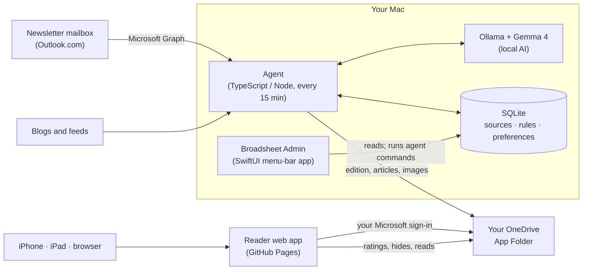

# The Broadsheet

**A private, AI-ranked newspaper made from your newsletters, running on your own Mac.**

The Broadsheet reads the newsletters arriving in a dedicated email account (Substack, beehiiv, Ghost and the like), plus blogs you follow by URL, and turns them into a sectioned "newspaper" you read on your iPhone, iPad or any browser. A local AI model summarizes, files and ranks every item for *you*, learning from your ratings and your own words. Nothing about your reading leaves your own Mac and your own Microsoft account.

---

## Executive summary

| | |
|---|---|
| **Problem** | Dozens of newsletters a day bury the few pieces worth reading, and the inbox has no notion of what you care about. |
| **Solution** | An agent on a Mac reads each newsletter as it arrives, has a local AI model summarize, file and score it, and publishes a ranked paper to a private folder that a web app on your phone reads. |
| **Privacy** | No cloud AI, no server, no third-party service. The AI runs on the Mac; the paper lives in your own OneDrive App Folder; the reader signs in with your Microsoft account. Article text is kept only for a few days. |
| **Cost** | Free to run: open-source model (Gemma via Ollama), a free Outlook.com account, GitHub Pages for the web app. |
| **Status** | In daily use. Personalization, hiding and rules, roundups, model comparison and a native Mac admin app are built (Phases 0–3). Next: packaging it so others can set up their own copy. |

## What it does

- **Reads and files your newsletters.** New mail is collected every 15 minutes. Each newsletter becomes a source automatically, and its emails are filed into Outlook folders that mirror the paper's sections. Account mail (sign-ins, receipts, welcomes) is left alone.
- **Summarizes and ranks with a local AI.** Gemma 4 (12B) writes a summary and key points, picks a section, and scores how interesting each item is *to you*. The ranking blends that with your ratings of authors and topics, freshness, and how widely a story is covered.
- **Learns from you.** 👍 👌 👎 ratings with an optional "why", a free-text **In your own words** profile, and rules written in plain English ("never show crypto posts") or as exact conditions. Gemma drafts rule suggestions from what you hide, and nothing is hidden beyond one item until you approve.
- **Handles real newsletters.** Roundups (many short stories in one email) are split into briefs: **News in Brief** on the Front Page, **In brief** on each section. The same story from several newsletters is matched, shown once as a brief, and ranked higher. Newsletters you always want, such as a daily letter, get a pinned panel, and the day's cartoon has its own spot.
- **Respects the Mac it runs on.** The Mac is also someone's personal computer, so AI work runs only when nobody is using it (idle time, memory, load and thermal checks) and gives the memory back when done.
- **Keeps your place across devices.** Ratings, saves, hides and what you've read sync between your phone, tablet and computer; read articles drop out after a refresh.
- **Stays safe on a home computer.** Daily database backups (and a weekly copy in OneDrive), an integrity check before every run, atomic file writes, and repair of anything a power cut interrupts.

## How it works



1. **Collect** (no AI): fetch new mail and feed posts, recognise the source, apply exact rules, file the email, clean the article, split roundups.
2. **Publish**: rank and write the edition and its articles to the OneDrive App Folder, so new items appear straight away with their opening lines.
3. **Read** (AI, only while the Mac is idle): Gemma summarizes, sections and scores each item, checks your plain-English rules, matches the same story across newsletters, and the paper is republished.
4. **Your actions** from any device travel back through the same private folder and are applied at the start of the next run.

## Privacy by design

- **One dedicated account.** The Broadsheet signs in only to a newsletter-only Outlook.com account, never your personal mailbox.
- **No cloud AI.** Every summary, score and rule check is done by an open model on your own Mac.
- **No server.** The web app is static files; it reads only its own OneDrive App Folder, with your own Microsoft sign-in, and can't see the rest of your OneDrive.
- **Little kept, briefly.** Articles, summaries and images are deleted after a few days. What's kept long term is your sources, rules, settings, your own words, and what you rated (titles and ratings, never article text).
- **Your data, exportable.** Export and import everything as one file; forget any rating, or all of them.

## Repository

| Path | What it is |
|---|---|
| [`apps/agent`](apps/agent) | The agent and its `broadsheet` command line (TypeScript, Node 26, SQLite via `node:sqlite`, Microsoft Graph, Ollama). |
| [`apps/reader`](apps/reader) | The reader web app (React, Vite, installable PWA, works offline), deployed to GitHub Pages. |
| [`apps/admin`](apps/admin) | Broadsheet Admin, the Mac menu-bar app (SwiftUI): status, sources, sections, email, rules, settings, data. |
| [`packages/shared`](packages/shared) | Schemas shared by the agent and the reader (Zod): config, edition, actions, rules. |
| [`PLAN.md`](PLAN.md) | The architecture and implementation plan, with every design decision. |
| [`docs/`](docs) | What each phase built, in detail: [Phase 1](docs/phase-1.md) · [Phase 2](docs/phase-2.md) · [Phase 3](docs/phase-3.md). |

## Getting around

```bash
pnpm install
pnpm test                    # the agent's tests (Vitest)
pnpm typecheck
apps/admin/build.sh --test   # Broadsheet Admin's tests (Swift Testing)
apps/admin/build.sh          # build and install Broadsheet Admin
pnpm agent doctor            # check sign-in, Outlook folders, OneDrive and Ollama
pnpm agent run               # what the schedule runs every 15 minutes
```

Every change Admin makes is also a `broadsheet` command (`sources`, `sections`, `rules`, `mail`, `settings`, `backups`, `eval` and more); `pnpm agent` on its own lists them.

**Requirements:** a Mac (Apple silicon, 16 GB or more; built on an M4 with 24 GB), Node 26 and pnpm, Ollama with `gemma4:12b`, a free Outlook.com account for newsletters, a Microsoft Entra app registration (free), and Xcode for the Admin app. A step-by-step setup guide for your own copy is the next milestone.

## Status

| Phase | Scope | |
|---|---|---|
| 0 | Spikes: sign-in, mail, OneDrive, Gemma, activity sensing | ✅ |
| 1 | The working paper: collect, summarize, file, publish, read on the phone, run unattended | ✅ |
| 2 | Personalization: ratings, learning, hiding and rules, your own words, roundups, model comparison | ✅ |
| 3 | Broadsheet Admin, the Mac app; following by URL; backups and crash safety | ✅ |
| 4 | Ready to share: install script and guide so anyone can run their own copy | Next |

Podcasts are deliberately out of scope; they'll be a separate app.
